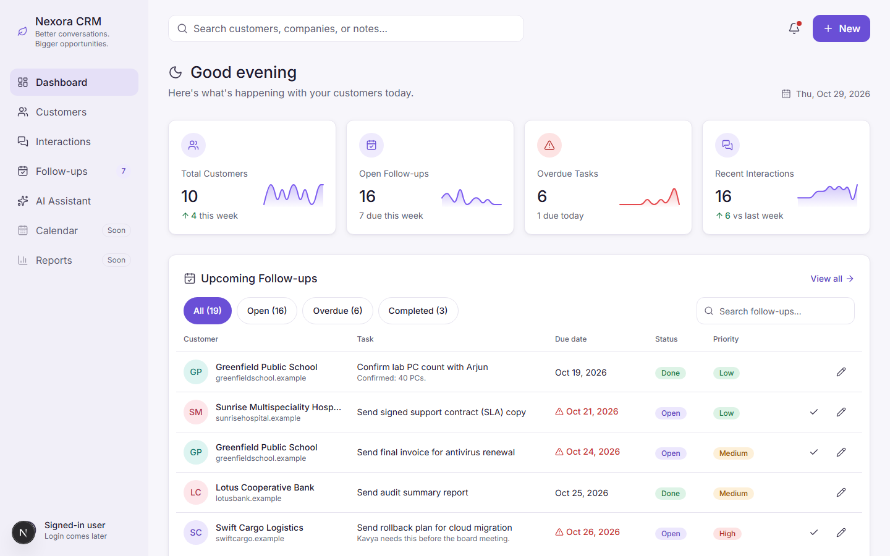
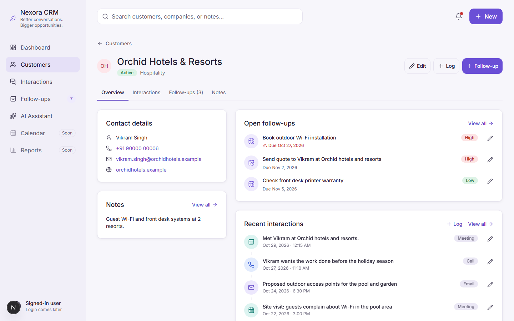
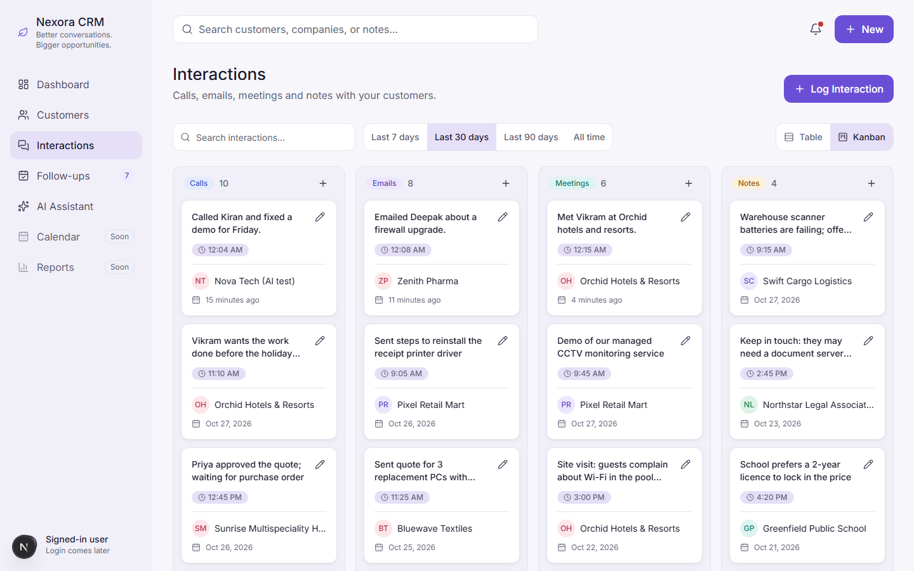
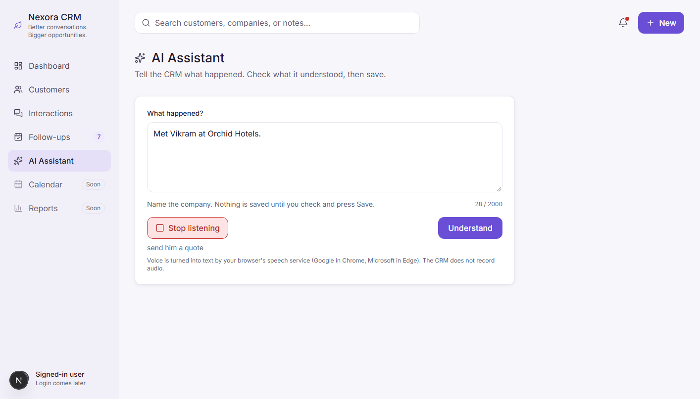
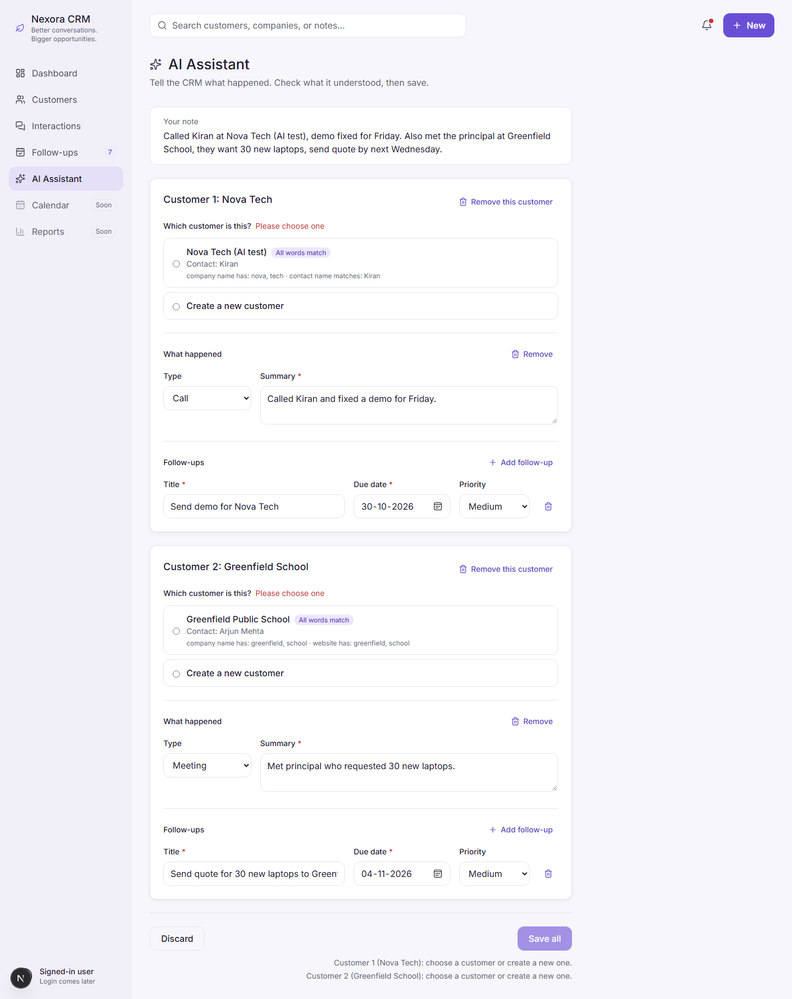
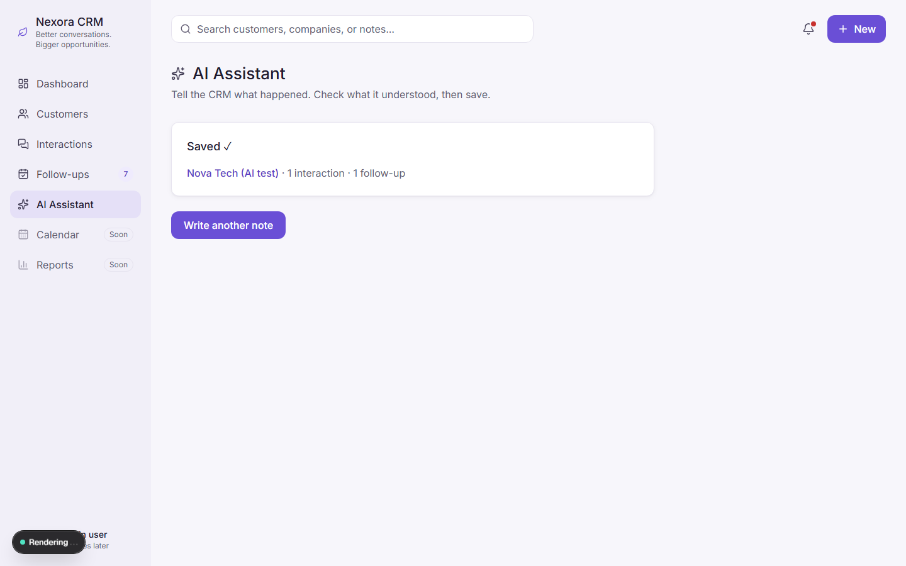
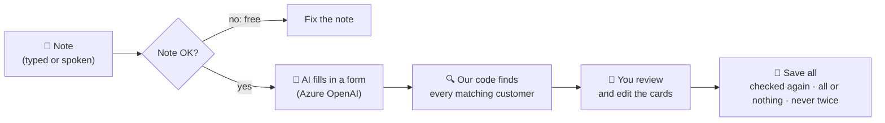
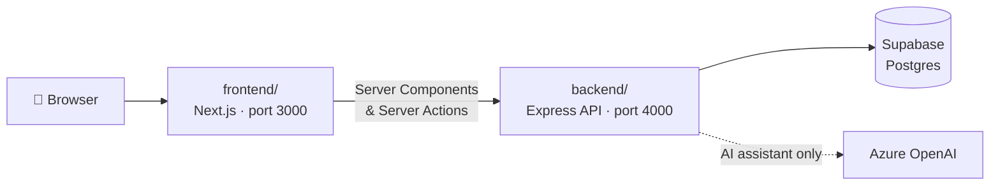

<div align="center">

# 🌿 Nexora CRM

**Better conversations. Bigger opportunities.**

An internal CRM for an IT services company, with an **AI assistant** that turns
what you type or say into customers, interactions and follow-ups.


[Features](#-features) · [AI Assistant](#-the-ai-assistant) · [Quick start](#-quick-start) · [Testing](#-testing) · [Troubleshooting](#-troubleshooting)



</div>

> [!WARNING]
> **Local use only for now.** There is no login yet (it is the next big step), and every
> AI request costs money. Run it on your own computer, never on the internet.

---

## ✨ Features

| | Page | What you can do |
|:-:|---|---|
| 📊 | **Dashboard** | Stat cards with trends, upcoming and overdue follow-ups, recent activity, quick actions |
| 🏢 | **Customers** | Search, add and edit; a full customer page with tabs: Overview, Interactions, Follow-ups, Notes |
| 💬 | **Interactions** | Kanban board or table of calls, emails, meetings and notes; search and date filters |
| ✅ | **Follow-ups** | Due today, overdue and upcoming; create, edit, mark done |
| ✨ | **AI Assistant** | Type or 🎤 **speak** a note → check what the AI understood → **Save all** with one click |

<table>
  <tr>
    <td width="50%"><p align="center"><sub><b>Customer page</b>: everything about one customer</sub></p></td>
    <td width="50%"><p align="center"><sub><b>Interactions</b>: Kanban board by type</sub></p></td>
  </tr>
</table>

---

## ✨ The AI Assistant

Write what happened in plain words, even in Hinglish, or press **🎤 Speak**:

> *"Met Vikram at Orchid Hotels and Resorts, send him a quote by Monday, urgent.
> Also Kiran from Nova Tech wants a demo next week."*

The assistant shows **one card per customer** with the meeting and follow-ups it understood.
You check, edit and save.

<table>
  <tr>
    <td width="34%"><p align="center"><sub><b>1. Type or speak</b></sub></p></td>
    <td width="33%"><p align="center"><sub><b>2. Check the cards</b></sub></p></td>
    <td width="33%"><p align="center"><sub><b>3. Saved ✓</b></sub></p></td>
  </tr>
</table>

### How it keeps your data safe



| Rule | What it means |
|---|---|
| 🤖 **The AI only reads and suggests** | It never sees the database, never picks a customer and never saves |
| 🔍 **Every possible customer is listed** | With the reasons it matched. Only one clear, exact match is pre-selected |
| 👀 **Nothing is saved until you press Save all** | Save stays disabled until every customer is chosen |
| 💾 **Saved all or nothing, and never twice** | A double click or retry says "already saved" instead of saving twice |

Full design and decisions: [`docs/ai-assistant-flow.md`](docs/ai-assistant-flow.md)

---

## 🚀 Quick start

### Prerequisites

- **Node.js 22+** (tested with 24) and npm
- A **Supabase** project (PostgreSQL)
- **Azure OpenAI** settings, only for the AI assistant (ask the team lead)

### 1 · Install

```bash
git clone <repo-url>
cd CRM
cd backend  && npm install      # also generates the Prisma client
cd ../frontend && npm install
```

### 2 · Add your settings

```bash
cp backend/.env.example  backend/.env           # secrets: database + Azure OpenAI
cp frontend/.env.example frontend/.env.local    # optional: only BACKEND_URL
```

| Setting in `backend/.env` | Where to get it |
|---|---|
| `DATABASE_URL` | Supabase → **Connect** → the *pooled* connection string |
| `DIRECT_URL` | Supabase → **Connect** → the *direct / session* connection string (for migrations) |
| `AZURE_OPENAI_*` (5 values) | Team lead / Azure portal. Without them the CRM works, but the assistant says *"not set up"*. |

> [!CAUTION]
> `backend/.env` holds **secrets**. It is ignored by git: never commit it, never put it in
> `frontend/`, and never paste it into a chat.

### 3 · Create the tables and demo data

```bash
cd backend
npx prisma migrate deploy   # creates the tables (only applies missing migrations)
npm run db:seed             # 8 demo customers with interactions and follow-ups
```

### 4 · Run (two terminals)

```bash
cd backend  && npm run dev   # API     → http://localhost:4000/health
cd frontend && npm run dev   # Website → http://localhost:3000
```

> [!TIP]
> Open **http://localhost:3000** and click **AI Assistant** in the sidebar to try the assistant.

---

## 🧪 Testing

### Automatic tests: free, no internet, no real database

```bash
cd backend  && npm test && npm run typecheck              # ~536 tests
cd frontend && npm test && npx tsc --noEmit && npx eslint src   # ~262 tests
```

The AI tests use a **fake AI** that replays real answers recorded earlier, so they cost nothing.

### Check the AI connection (run in `backend/`)

| Command | What it shows | Cost |
|---|---|:-:|
| `npm run ai:hello` | Both Azure deployments answer one sentence | ~₹0.01 |
| `npm run ai:prompt` | Answers **without** vs **with** the CRM instructions | ~₹0.15 |
| `npm run ai:understand` | The AI's structured answer (JSON) for sample notes | ~₹0.10 |
| `npm run ai:find` | Customer matching on the demo data, **no AI** | ₹0 |

### Try the AI Assistant by hand

Paste a note at **http://localhost:3000/assistant**, press **Understand**, then **Save all** or **Discard**.

<details>
<summary><b>📋 9 sample notes and what you should see</b> (click to open)</summary>
<br>

| Paste this note | You should see |
|---|---|
| `Met Vikram Singh at Orchid Hotels & Resorts today, he wants a quote for 40 Wi-Fi access points by Monday, urgent.` | Customer **pre-selected** (exact name), Meeting, follow-up **High** |
| `Called Priya at Sunrise Hospital, the X-ray PCs are slow again, send a technician tomorrow.` | **Choose**: close to "Sunrise Multispeciality Hospital", but not the exact name |
| `Emailed Deepak at Zenith Pharma about a firewall upgrade, follow up next Friday.` | **Create a new customer** (pre-filled) |
| `Send the proposal to them next week.` | No customer, only the question "Which customer?" |
| `Visited Lotus Cooperative Bank and met Rahul Iyer about ATM software. Also Sneha from Bluewave Textiles called, their printer is down, fix it today.` | **Two cards**, each with its own records |
| `Talked to Kavya at Swift Cargo Logistics about GPS trackers, no rush, check back on 15 November.` | *"The AI guessed this"* on the type, priority **Low** |
| `Called Ananya at Northstar Legal Associates, she wanted the invoice by 20 October.` | **Please check:** the due date is in the past |
| `Farhan from Pixel Retail Mart ne call kiya, billing software mein problem hai, kal fix karna hai.` | Hinglish in, **English** out, due tomorrow |
| `?????` | Stopped before the AI: *"The note has no words in it"* (free) |

**Also check:**
- **Save all** stays disabled until every customer is chosen, and it lists why.
- Click **Save all** twice quickly: it is saved **once** ("already saved").
- After saving, the records appear on the Dashboard, Interactions, Follow-ups and customer pages.

</details>

| Action | Uses the AI? | Cost |
|---|:-:|:-:|
| **Understand** | ✅ one call | ~₹0.03–0.05 |
| Too-short or wordless note | ❌ stopped first | ₹0 |
| Editing cards, **Discard**, **Save all** | ❌ | ₹0 |

> [!IMPORTANT]
> **Save all writes real records** into your data. Use **Discard** if you only want to look.

### 🎤 Voice input

In **Chrome or Edge**: press **Speak** → allow the microphone → talk → **Stop listening** →
check the text → **Understand**. Firefox has no built-in speech-to-text and shows a "please type" note.

> [!NOTE]
> **Privacy:** the browser's own service turns the voice into text (Google in Chrome,
> Microsoft in Edge), so the audio leaves your computer. The CRM never stores audio.
> Confirm this is acceptable before using it with real customer details.

---

## 🏗️ How it is built



The browser **never** talks to the backend directly. Only the Next.js server does, so the
backend address and every secret stay on the server.

| Part | Technology |
|---|---|
| Frontend | Next.js 16 (App Router, Server Components, Server Actions), React 19, Tailwind CSS 4, lucide icons |
| Backend | Node.js, Express 5, TypeScript, Prisma 7 |
| Database | PostgreSQL on Supabase |
| AI | Azure OpenAI with structured output (the AI fills in a fixed form) |
| Voice | The browser's built-in speech-to-text, behind a swappable interface |
| Tests | Vitest, supertest |

<details>
<summary><b>📁 Folder structure</b></summary>
<br>

```
CRM/
├── backend/
│   ├── prisma/              database schema + migrations
│   └── src/
│       ├── customers/ interactions/ followUps/ dashboard/   API routes + validation
│       ├── ai/              the AI assistant (instructions, form, matching, decisions, save)
│       └── demoData/        npm run db:seed
├── frontend/
│   └── src/
│       ├── app/             pages (dashboard, customers, interactions, follow-ups, assistant)
│       ├── components/      UI pieces
│       └── lib/             logic, API helpers, formatting
├── docs/
│   ├── ai-assistant-flow.md how a note becomes CRM records
│   └── images/              screenshots for this README
└── CLAUDE.md                working rules for the AI coding assistant
```

</details>

<details>
<summary><b>🔌 API endpoints (backend, port 4000)</b></summary>
<br>

| Method and path | Purpose |
|---|---|
| `GET /health` | Is the server alive? |
| `GET /dashboard` | Numbers and lists for the dashboard |
| `GET, POST /customers` · `GET, PATCH, DELETE /customers/:id` | Customers (`?q=` to search) |
| `GET, POST /interactions` · `GET, PATCH, DELETE /interactions/:id` | Interactions (filters: `q`, `type`, `range`, `customerId`) |
| `GET, POST /follow-ups` · `GET, PATCH, DELETE /follow-ups/:id` | Follow-ups |
| `POST /ai/understand` | Note → review plan (**saves nothing**, one AI call) |
| `POST /ai/save` | Save a confirmed review (no AI, safe to repeat) |

</details>

---

## 🩺 Troubleshooting

<details>
<summary><b>Something not working? Click for common problems</b></summary>
<br>

| You see | Why | Fix |
|---|---|---|
| `ECONNREFUSED` / "Could not reach the backend" | The backend is not running | `cd backend && npm run dev` |
| `TimeoutError` on the first page load | The database is in Sydney; the first connections after a quiet period are slow | Reload the page (it is fast once warm) |
| *"The AI assistant is not set up."* | Azure settings missing in `backend/.env` | Fill them in, then `npm run ai:hello` |
| *"The AI is not available right now."* | Azure unreachable, or a wrong key | `npm run ai:hello` shows the exact reason |
| *"Microphone access was blocked"* | The browser's mic permission is off | Address bar icon → allow the microphone |
| Old styles or a strange page after updates | Stale Next.js cache | Stop the frontend, delete `frontend/.next`, start again |

</details>

---

## 🗺️ Roadmap and known limits

- [x] Customers, interactions, follow-ups and dashboard
- [x] AI assistant: understand → review → save, with safe customer matching
- [x] Voice input (browser speech-to-text)
- [ ] **Login and permissions.** Must come before anyone else uses the CRM.
- [ ] A limit on AI requests per person per minute
- [ ] Better voice for Indian languages (e.g. Sarvam AI), using the swappable "ears"
- [ ] Customer matching that tolerates typos ("Sunrsie" → Sunrise)

> [!NOTE]
> The test customer **"Nova Tech (AI test)"** was created while building the save step.
> Delete it when it is no longer needed.
